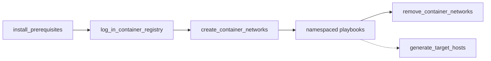

# LFDT Chaguar Ansible Playbooks

This directory contains the reusable playbooks that the `lfdt.chaguar` collection provides. They compose the collection roles into standard Chaguar lifecycle operations and are the building blocks for any Ansible project that deploys a Chaguar network.

## Table of Contents <!-- omit in toc -->

- [Playbook Usage](#playbook-usage)
- [install\_prerequisites.yaml](#install_prerequisitesyaml)
- [log\_in\_container\_registry.yaml](#log_in_container_registryyaml)
- [create\_container\_networks.yaml](#create_container_networksyaml)
- [remove\_container\_networks.yaml](#remove_container_networksyaml)
- [generate\_target\_hosts.yaml](#generate_target_hostsyaml)
- [openshift/config\_hosts.yaml](#openshiftconfig_hostsyaml)
- [Network Lifecycle Playbooks](#network-lifecycle-playbooks)
- [Namespaced Playbooks](#namespaced-playbooks)

## Playbook Usage

Each playbook can be run by its fully-qualified collection name:

```shell
ansible-playbook lfdt.chaguar.orderer.start
```

The top-level playbooks prepare shared host resources around the component-specific lifecycle. The normal setup flow runs prerequisites first, logs in to registries when private images are used, creates container networks for container-mode inventories, and then runs the namespaced playbooks for artifacts, configuration, services, and cleanup.



## install_prerequisites.yaml

[`install_prerequisites.yaml`](./install_prerequisites.yaml) prepares the machines that will run Chaguar services. It first selects one representative inventory host per physical machine, then installs the shared operating-system and runtime prerequisites used by the rest of the collection: container engine support, tmux, OpenSSL, Git, Go, rsync, and chrony.

```shell
ansible-playbook lfdt.chaguar.install_prerequisites --extra-vars '{"target_hosts": "all"}'
```

Properties:

- Target hosts: `all` by default for host discovery, then the generated `machines` group for installation.
- Nuance: only one representative host per physical machine installs packages, which avoids repeating package operations when several inventory hosts map to the same `ansible_host`.
- Nuance: use `target_hosts` to prepare only a subset of the inventory.

## log_in_container_registry.yaml

[`log_in_container_registry.yaml`](./log_in_container_registry.yaml) authenticates the deployment against a private container registry. It logs the container engine in once per physical machine, then creates Kubernetes image pull secrets once per selected Kubernetes namespace when Kubernetes hosts are present.

```shell
ansible-playbook lfdt.chaguar.log_in_container_registry --extra-vars '{"target_hosts": "all"}'
```

Properties:

- Target hosts: `all` by default for host and namespace discovery, then the generated `machines` and `k8s_namespaces` groups for the actual login and pull-secret steps.
- Nuance: requires the registry variables consumed by the container and Kubernetes roles, including `container_registry`, `container_registry_username`, and `container_registry_password`.
- Nuance: useful before starting container or Kubernetes deployments that pull private images.

## create_container_networks.yaml

[`create_container_networks.yaml`](./create_container_networks.yaml) creates the container networks declared by the selected inventory hosts. It deduplicates work by building one execution target per `(ansible_host, container_network)` pair, so each required network is created once on each machine that needs it.

```shell
ansible-playbook lfdt.chaguar.create_container_networks --extra-vars '{"target_hosts": "all"}'
```

Properties:

- Target hosts: `localhost` for discovery, then the generated `machines_with_container_networks` group for network creation.
- Nuance: only hosts with `container_network` defined contribute a network target.
- Nuance: run this before starting container-mode deployments that expect a pre-created network.

## remove_container_networks.yaml

[`remove_container_networks.yaml`](./remove_container_networks.yaml) removes the container networks that were created for the selected inventory hosts. It uses the same `(ansible_host, container_network)` deduplication as the create playbook, which makes cleanup operate once per machine and network.

```shell
ansible-playbook lfdt.chaguar.remove_container_networks --extra-vars '{"target_hosts": "all"}'
```

Properties:

- Target hosts: `localhost` for discovery, then the generated `machines_with_container_networks` group for network removal.
- Nuance: only hosts with `container_network` defined contribute a network target.
- Nuance: run this after component teardown when the deployment no longer needs its container networks.

## generate_target_hosts.yaml

[`generate_target_hosts.yaml`](./generate_target_hosts.yaml) regenerates the Makefile helper targets for the selected inventory. It reads `groups['all']` and writes `target_hosts.mk` under `project_dir`, giving the top-level `Makefile` one target per inventory host that maps to `TARGET_HOSTS`.

```shell
ansible-playbook lfdt.chaguar.generate_target_hosts
```

Properties:

- Target hosts: `localhost`.
- Nuance: writes `target_hosts.mk` to `project_dir`.
- Nuance: normally used by `make targets`, but it can be run directly after inventory changes when you want the generated host-specific Makefile targets refreshed.

## openshift/config_hosts.yaml

[`openshift/config_hosts.yaml`](./openshift/config_hosts.yaml) configures local hosts entries for OpenShift Route hosts declared in the current inventory. It maps each route host to the control node's default IPv4 address, which is useful for local OpenShift deployments when route DNS resolves to `127.0.0.1` but containerized clients need a non-loopback address.

```shell
ansible-playbook lfdt.chaguar.openshift.config_hosts --ask-become-pass
```

Properties:

- Target hosts: `localhost`.
- Nuance: supported on Linux and macOS; the playbook fails before editing `/etc/hosts` on other operating systems.
- Nuance: `/etc/hosts` does not support wildcards, so this playbook enumerates route hostnames from inventory and writes them in one managed block.
- Nuance: rerun the playbook when the control node's default-route IPv4 address changes or after the local OpenShift runtime rewrites `/etc/hosts`.

## Network Lifecycle Playbooks

The top-level lifecycle playbooks chain the namespaced playbooks of every component family, in dependency order, into one network-wide step. Families with no hosts in the inventory are skipped, so the same playbooks work for every sample inventory.

| Playbook                                                 | What it does                                                                                                         |
| -------------------------------------------------------- | -------------------------------------------------------------------------------------------------------------------- |
| [`binaries.yaml`](./binaries.yaml)                       | Builds or installs the binaries of every component on the control node.                                              |
| [`generate_crypto.yaml`](./generate_crypto.yaml)         | Creates container networks, generates the crypto material, and brings up the Fabric CAs when the inventory has them. |
| [`build_genesis_block.yaml`](./build_genesis_block.yaml) | Builds the genesis block. Runs only when the inventory has a `network` group.                                        |
| [`configs.yaml`](./configs.yaml)                         | Renders and transfers the configuration of every component.                                                          |
| [`start.yaml`](./start.yaml)                             | Starts every component, databases first.                                                                             |
| [`init.yaml`](./init.yaml)                               | Creates the namespaces on the committer.                                                                             |
| [`deploy.yaml`](./deploy.yaml)                           | Runs `binaries` to `init` in one invocation, which shares gathered facts between the steps.                          |
| [`stop.yaml`](./stop.yaml)                               | Stops every component in reverse dependency order, keeping data and configuration.                                   |
| [`teardown.yaml`](./teardown.yaml)                       | Stops every component and deletes its runtime data, then removes the container networks.                             |
| [`wipe.yaml`](./wipe.yaml)                               | Removes generated configuration and binaries from the hosts, then removes the container networks.                    |
| [`ping.yaml`](./ping.yaml)                               | Checks that the declared ports of every component are open.                                                          |

```shell
ansible-playbook lfdt.chaguar.deploy -i inventory.yaml
ansible-playbook lfdt.chaguar.teardown -i inventory.yaml
```

Properties:

- Target hosts: each imported playbook keeps its own default group, and `target_hosts` narrows the component playbooks that honor it. The crypto material and genesis block builders in `generate_crypto` and `build_genesis_block` run on `localhost` and always use the inventory-wide groups.
- Nuance: `make setup start init` runs the same steps one by one, while `deploy` is a single invocation.
- Nuance: `binaries`, `generate_crypto`, `configs`, `start`, `stop`, `teardown`, and `wipe` also drive Semaphore UI, but only when the inventory defines a `semaphore_ui` group.

## Namespaced Playbooks

Namespaced playbooks are collections of playbooks tailored for a specific group of hosts:

| Namespace                                        | Description                                                                                                                                                           |
| ------------------------------------------------ | --------------------------------------------------------------------------------------------------------------------------------------------------------------------- |
| [artifacts](./artifacts/README.md)               | Generates network-wide crypto material and the genesis block on the control node. Not tied to a remote host group.                                                    |
| [fabric_ca_server](./fabric_ca_server/README.md) | Operates Fabric CA servers: start, enroll admins, register identities, stop, teardown, and wipe.                                                                      |
| [fabric_ca_client](./fabric_ca_client/README.md) | Prepares the Fabric CA client binary used by enrollment and registration tasks.                                                                                       |
| [postgres](./postgres/README.md)                 | Operates every PostgreSQL database in the inventory in one pass: crypto, configs, start, stop, teardown, wipe, ping. Serves Fabric CA, committer, and Block Explorer. |
| [orderer](./orderer/README.md)                   | Operates Chaguar orderer components (routers, batchers, consenters, assemblers) targeting the `chaguar_orderers` group.                                               |
| [committer](./committer/README.md)               | Operates Chaguar committer services targeting the `chaguar_committers` group, backed by PostgreSQL or YugabyteDB.                                                     |
| [block_explorer](./block_explorer/README.md)     | Operates the Block Explorer server and UI, backed by PostgreSQL, targeting the `chaguar_block_explorer` group.                                                        |
| [evm](./evm/README.md)                           | Operates the Chaguar EVM gateway and its embedded endorser, targeting the `chaguar_evm` group.                                                                        |
| [fxconfig](./fxconfig/README.md)                 | Builds, endorses, and submits Chaguar configuration transactions including namespace creation. Run after `start` during initialization.                               |
| [loadgen](./loadgen/README.md)                   | Operates load generators: start, stop, reconfigure submission rate at runtime, collect metrics and logs.                                                              |
| [monitoring](./monitoring/README.md)             | Operates observability components: Prometheus, Grafana, Loki, Alloy, node exporter, PostgreSQL exporter, Elasticsearch, and Jaeger.                                   |
| [semaphore_ui](./semaphore_ui/README.md)         | Operates Semaphore UI (Ansible automation controller) as a binary on its own control node: binaries, generate_crypto, configs, start, stop, teardown, wipe.           |
| [yugabyte](./yugabyte/README.md)                 | Operates every YugabyteDB cluster in one pass: crypto, configs, start, stop, teardown, wipe, ping. Also provides a standalone TLS CA path.                            |
